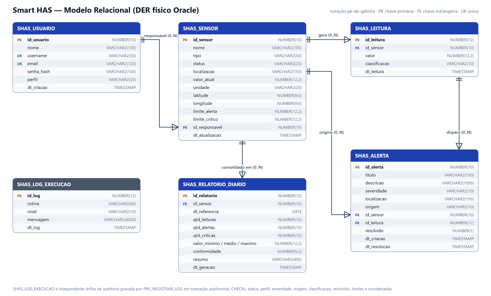
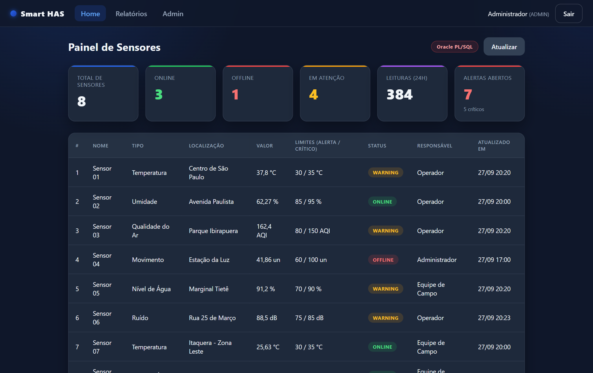
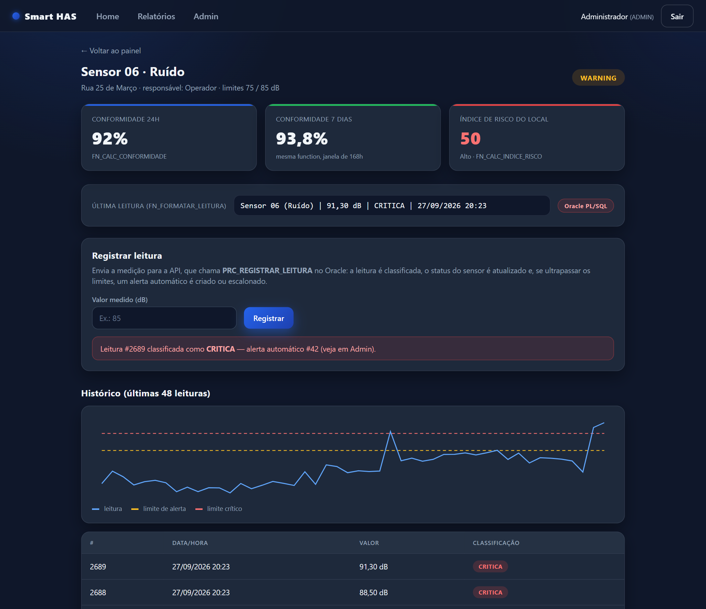
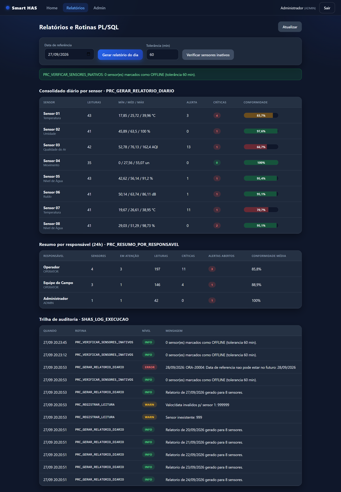
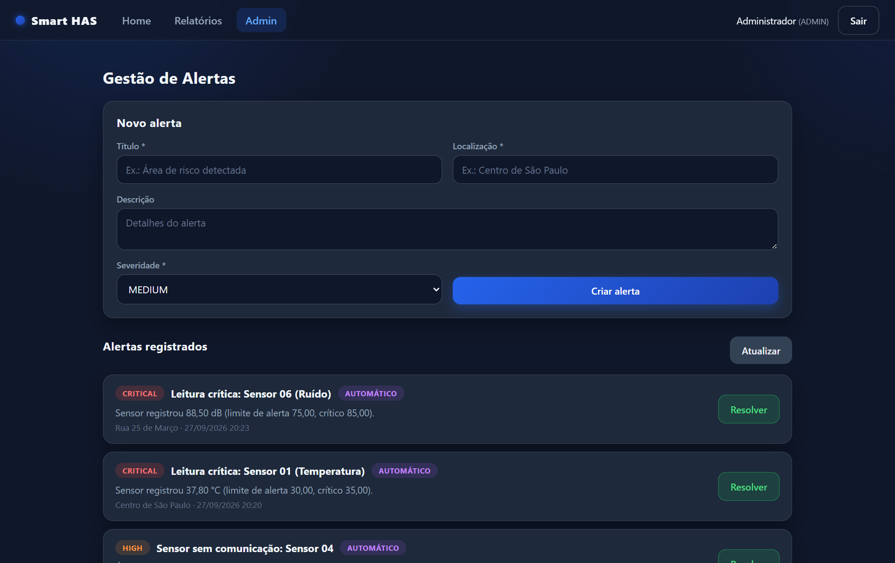
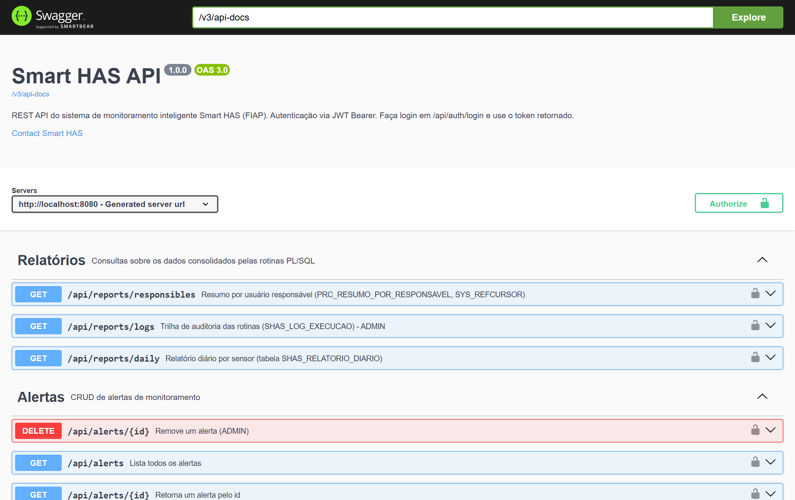

# Smart HAS — Documentação do Projeto (Fase 6)

Integração do Oracle PL/SQL ao ecossistema Smart HAS (mobile, web, API REST e banco de dados)

## 1. Identificação do grupo

| Nome completo | RM | Foto |
|---|---|---|
| Giovanna Cardoso Pinheiro Cury Marques | 554433 | (inserir foto) |

- **Repositório GitHub:** (colar link do repositório da Fase 6)
- **Vídeo de apresentação (YouTube, não listado):** (colar link)

## 2. Visão geral

O **Smart HAS** é um sistema inteligente de monitoramento urbano (sensores IoT, alertas e áreas de risco), alinhado à Sociedade 5.0 e com a camada **AI Logistics Extension**. Na Fase 5 o sistema chegou a um MVP conectado: app **Flutter**, API **Spring Boot** e dashboard **Angular**, todos consumindo a mesma API REST sobre um banco H2 em memória.

Na **Fase 6**, a solução ganhou uma **camada de persistência Oracle**. A inteligência de monitoramento passou a rodar **dentro do banco**, em **functions e procedures PL/SQL** chamadas pelo back-end Java via JDBC. Essa inteligência inclui classificar leituras, gerar e escalonar alertas, calcular indicadores, consolidar relatórios e detectar sensores sem comunicação.

**Fluxo de ponta a ponta:** Flutter / Angular → REST + JWT → Spring Boot (Controller → Service → Gateway) → JDBC → Oracle (PL/SQL).

## 3. Parte 1 — Aprimoramento da solução

### 3.1 Novas funcionalidades

| Funcionalidade | Onde | Valor agregado |
|---|---|---|
| Telemetria: registro e histórico de leituras por sensor | API, Angular, Flutter | O sistema passa a guardar uma série temporal, e não só o "último valor" |
| Classificação automática NORMAL / ALERTA / CRÍTICA com limites por sensor | Oracle + API | Regra única e parametrizável, sem valores fixos no código |
| Alertas automáticos com deduplicação e escalonamento | Oracle (PRC_REGISTRAR_LEITURA) | Evita "tempestade" de alertas e escala ALERTA → CRÍTICO sozinho |
| Indicadores de conformidade (24h/7d) e índice de risco por local | Oracle (functions) + telas | KPIs de qualidade operacional para apoiar decisões |
| Relatório diário consolidado por sensor | Oracle (batch) + tela Relatórios | Visão gerencial idempotente, reprocessável por data |
| Watchdog de sensores inativos (OFFLINE + alerta) | Oracle (batch + DBMS_SCHEDULER) | Detecta pontos cegos do monitoramento sem ação humana |
| Resumo por responsável (SYS_REFCURSOR) | Oracle + tela Relatórios | Mostra a carga e a situação de cada equipe |
| Trilha de auditoria das rotinas | Oracle (transação autônoma) + tela ADMIN | Governança: toda execução e todo erro ficam registrados |
| Responsável e limites no cadastro de sensor | API / modelo | Base para a gestão por equipe |
| Simulador de gateway IoT (opcional) | API (@Scheduled) | Demonstra a procedure disparada por evento de back-end |

### 3.2 Refatorações e boas práticas

- **Ports & Adapters (Hexagonal):** os services dependem da interface `SensorAnalyticsGateway`. A implementação é escolhida pelo perfil Spring ativo: `OraclePlSqlAnalyticsGateway` (perfil `oracle`, regras no PL/SQL) ou `JpaAnalyticsGateway` (H2, mesmas regras em Java, para rodar testes e a demo sem Oracle).
- **Schema como fonte da verdade:** no Oracle o Hibernate roda com `ddl-auto=validate`. O schema é versionado por scripts SQL, e a API não sobe se as entidades divergirem das tabelas. Essa validação apontou (e nos fez corrigir) o mapeamento `Double` → `NUMBER(12,2)`.
- **Tradução de erros do banco:** `RAISE_APPLICATION_ERROR` −20001 vira HTTP 404, e de −20002 a −20004 vira HTTP 422, sempre com a mensagem de negócio definida no PL/SQL.
- **Controle transacional explícito:** a procedure online não faz COMMIT e roda dentro do `@Transactional` do service (leitura, sensor e alerta são confirmados juntos). As rotinas batch controlam o próprio COMMIT e podem rodar sem a aplicação, via DBMS_SCHEDULER.
- **Contrato retrocompatível:** os campos novos (`alertThreshold`, `origin`, `resolvedAt`...) são aditivos, e os clientes da Fase 5 continuam funcionando.
- **Validações reforçadas:** tamanho de campos, faixas de coordenadas, `criticalThreshold ≥ alertThreshold`, `measuredAt` não futuro. Violações de constraint viram HTTP 409.
- **Front-end:** KPIs da Home passaram a vir do back-end (antes eram calculados no navegador). Estilos compartilhados foram movidos para o design system global, e a localização passou a ser pt-BR (números e datas).
- **Flutter:** política de mock/fallback centralizada no repositório (`_withFallback`) e alternância mock ↔ API sem editar código (`--dart-define=SMARTHAS_USE_MOCK=false`).
- **Testes:** 25 testes automatizados no H2 e 4 testes de integração contra o Oracle real.

### 3.3 Antes x depois

| Aspecto | Fase 5 | Fase 6 |
|---|---|---|
| Banco | H2 em memória (dados perdidos a cada restart) | Oracle 19c+/23ai com 6 tabelas, constraints e índices |
| Regras de negócio | Somente CRUD | 4 functions + 5 procedures PL/SQL |
| Alertas | Apenas manuais | Manuais + automáticos (criação, deduplicação, escalonamento) |
| Dados | 4 sensores e 3 alertas fixos | 8 sensores e ~2.700 leituras simuladas (7 dias) |
| Relatórios | — | Diário por sensor + resumo por responsável + auditoria |
| Automação | — | Jobs DBMS_SCHEDULER (watchdog 15 min, relatório 23:55) |
| Testes | 6 | 25 (H2) + 4 (Oracle) |

## 4. Parte 2 — Integração do banco Oracle

### 4.1 Modelo relacional (DER)



### 4.2 Tabelas criadas

| Tabela | Finalidade | Destaques |
|---|---|---|
| SHAS_USUARIO | Usuários da plataforma (login JWT) | UK username/email; CHECK perfil (ADMIN/OPERATOR); senha BCrypt |
| SHAS_SENSOR | Sensores IoT | FK responsável; limites de alerta/crítico; CHECK status, limites e coordenadas |
| SHAS_LEITURA | Série temporal de medições | FK sensor ON DELETE CASCADE; CHECK classificação; índice (id_sensor, dt_leitura) |
| SHAS_ALERTA | Alertas manuais e automáticos | FKs sensor/leitura (SET NULL); CHECK severidade, origem, resolvido |
| SHAS_RELATORIO_DIARIO | Consolidado diário por sensor | UK (id_sensor, dt_referencia); CHECK conformidade 0–100 |
| SHAS_LOG_EXECUCAO | Auditoria das rotinas PL/SQL | CHECK nível (INFO/WARN/ERROR); índice (rotina, dt_log) |

**Convenções:** prefixo `SHAS_` (evita colisão em schema compartilhado, como o servidor da FIAP), PK `IDENTITY`, constraints nomeadas (`PK_`, `FK_`, `UK_`, `CK_`), `COMMENT ON` em tabelas e colunas, e booleanos como `NUMBER(1)`, compatível com Oracle anterior ao 23ai.

### 4.3 Implantação e dados simulados

Os scripts ficam em `database/scripts` e o instalador `instalar_tudo.sql` executa tudo em ordem. Ele é reexecutável e termina listando os objetos inválidos (nenhum).

| Script | Conteúdo |
|---|---|
| 00_drop_objetos.sql | Remove objetos existentes (reinstalação segura) |
| 01_ddl_tabelas.sql | Tabelas, constraints, índices e comentários |
| 02_functions.sql / 03_procedures.sql | Camada PL/SQL |
| 04_carga_dados.sql | Carga simulada |
| 05_views.sql | VW_SHAS_PAINEL_SENSOR |
| 06_consultas_demo.sql | Demonstração de uso |
| 07_job_agendado.sql | Jobs DBMS_SCHEDULER (opcional) |

A **carga simulada** é gerada por um bloco PL/SQL com semente fixa, portanto é reprodutível. Ela cria 3 usuários, 8 sensores em São Paulo e **7 dias de telemetria a cada 30 minutos**, com valor = base + ciclo diário (senoide) + ruído gaussiano + picos críticos aleatórios (2%). Também gera alertas históricos já resolvidos e alertas manuais. Por fim, as próprias procedures são chamadas para produzir alertas automáticos e os relatórios dos últimos 8 dias.

Resultado real da instalação no Oracle 23ai (arquivo `database/evidencias/instalacao_saida.txt`):

```
TABELA                 REGISTROS
SHAS_USUARIO                   3
SHAS_SENSOR                    8
SHAS_LEITURA                2685
SHAS_ALERTA                   40
SHAS_RELATORIO_DIARIO         64
Objetos invalidos: no rows selected
```

Ambiente: `database/docker-compose.yml` sobe o Oracle Database 23ai Free e instala tudo automaticamente na primeira inicialização. Os mesmos scripts rodam no SQL Developer, no servidor Oracle da FIAP (19c).

## 5. Parte 3 — Functions e procedures PL/SQL

Todas as rotinas usam parâmetros `IN`/`OUT`, `RETURN` tipado com `%TYPE`, comentários de cabeçalho e tratamento de exceções com um catálogo de erros de negócio: −20001 sensor inexistente, −20002 valor inválido, −20003 parâmetro inválido e −20004 data inválida.

### 5.1 Functions

| Function | Tipo | Parâmetros → retorno | Propósito |
|---|---|---|---|
| FN_CALC_CONFORMIDADE | **Indicador** | p_id_sensor, p_horas (24), p_dt_fim → NUMBER 0–100 | % de leituras NORMAIS na janela — KPI de qualidade operacional |
| FN_CALC_INDICE_RISCO | **Indicador** | p_localizacao → NUMBER 0–100 | Risco do local: alertas abertos ponderados (CRITICAL 40, HIGH 25, MEDIUM 10, LOW 5) + sensores WARNING (10) / OFFLINE (15) |
| FN_FORMATAR_LEITURA | **Dados formatados** | p_id_sensor → VARCHAR2 | Última leitura pronta para exibição em pt-BR |
| FN_CLASSIFICAR_LEITURA | Regra de domínio | p_valor, limites → VARCHAR2 | NORMAL / ALERTA / CRITICA (DETERMINISTIC), reutilizada pelas procedures e pela carga |

**Boas práticas aplicadas:** validação dos parâmetros com `RAISE_APPLICATION_ERROR`, e conversão de `NO_DATA_FOUND` em erro de negócio. Isso importa porque, quando uma function chamada dentro de um SELECT levanta `NO_DATA_FOUND`, o Oracle devolve NULL em silêncio. Além disso: `RETURN NULL` quando não há dados (o indicador fica indefinido em vez de mostrar 0%) e constantes nomeadas para pesos e formatos.

```sql
CREATE OR REPLACE FUNCTION fn_calc_conformidade (
    p_id_sensor IN shas_sensor.id_sensor%TYPE,
    p_horas     IN NUMBER    DEFAULT 24,
    p_dt_fim    IN TIMESTAMP DEFAULT NULL
) RETURN NUMBER IS
    v_fim TIMESTAMP := NVL(p_dt_fim, SYSTIMESTAMP);
    v_existe NUMBER; v_total NUMBER; v_normais NUMBER;
BEGIN
    IF p_horas IS NULL OR p_horas <= 0 THEN
        RAISE_APPLICATION_ERROR(-20003, 'Janela de tempo deve ser maior que zero (horas).');
    END IF;
    SELECT 1 INTO v_existe FROM shas_sensor WHERE id_sensor = p_id_sensor;
    SELECT COUNT(*), COUNT(CASE WHEN classificacao = 'NORMAL' THEN 1 END)
      INTO v_total, v_normais
      FROM shas_leitura
     WHERE id_sensor = p_id_sensor
       AND dt_leitura >= v_fim - NUMTODSINTERVAL(p_horas, 'HOUR') AND dt_leitura < v_fim;
    IF v_total = 0 THEN RETURN NULL; END IF;
    RETURN ROUND(v_normais / v_total * 100, 2);
EXCEPTION
    WHEN NO_DATA_FOUND THEN
        RAISE_APPLICATION_ERROR(-20001, 'Sensor ' || p_id_sensor || ' nao encontrado.');
END fn_calc_conformidade;
```

**Uso prático em consultas SQL** (`06_consultas_demo.sql`): as functions são usadas no SELECT (view do painel), no WHERE (sensores com conformidade abaixo de 95%), no ORDER BY (ranking de risco por local) e em comparações de janelas (24h × 7 dias).

```sql
-- Ranking de risco por localizacao (function no SELECT e no ORDER BY)
SELECT localizacao, fn_calc_indice_risco(localizacao) AS indice_risco
  FROM (SELECT DISTINCT localizacao FROM shas_sensor)
 ORDER BY fn_calc_indice_risco(localizacao) DESC;

LOCALIZACAO              INDICE_RISCO NIVEL
Marginal Tietê                     75 ALTO
Parque Ibirapuera                  50 ALTO
Centro de São Paulo                40 MODERADO

-- Painel (VW_SHAS_PAINEL_SENSOR, construida sobre as functions)
Sensor 05 (Nível de Água) | 91,20 % | CRITICA | 27/09/2026 20:20   conf. 96   risco 75
Sensor 03 (Qualidade do Ar) | 162,40 AQI | CRITICA | 27/09/2026 20:20   conf. 69,39   risco 50
```

### 5.2 Procedures

| Procedure | Execução | Técnicas PL/SQL |
|---|---|---|
| PRC_REGISTRAR_LEITURA | **Online — acionada pelo back-end Java** | SAVEPOINT, SELECT … FOR UPDATE, IF/ELSIF, RETURNING INTO, exceção nomeada, EXCEPTION |
| PRC_GERAR_RELATORIO_DIARIO | Batch (API ou job 23:55) | CURSOR explícito + FOR LOOP, IF, MERGE (idempotente), functions, COMMIT/ROLLBACK |
| PRC_VERIFICAR_SENSORES_INATIVOS | Batch (API ou job a cada 15 min) | CURSOR parametrizado com OPEN/FETCH/CLOSE, %NOTFOUND, %ISOPEN, FOR UPDATE + WHERE CURRENT OF |
| PRC_RESUMO_POR_RESPONSAVEL | Consulta (API) | SYS_REFCURSOR de saída, subconsultas correlacionadas com function |
| PRC_REGISTRAR_LOG | Auxiliar | PRAGMA AUTONOMOUS_TRANSACTION (o log persiste mesmo após ROLLBACK) |

**PRC_REGISTRAR_LEITURA** (IN p_id_sensor, p_valor, p_dt_leitura; OUT p_id_leitura, p_classificacao, p_id_alerta) executa estes passos:

1. Valida o valor (faixa −1000 a 100000) e a data (não futura).
2. Trava o sensor com `SELECT … FOR UPDATE`, serializando leituras concorrentes do mesmo dispositivo.
3. Classifica a leitura com `FN_CLASSIFICAR_LEITURA`.
4. Insere no histórico.
5. Atualiza valor e status do sensor, mas só se a leitura for a mais recente (leituras atrasadas entram apenas no histórico).
6. Se a leitura for ALERTA ou CRÍTICA: cria um alerta automático; se já existir um aberto, reaproveita, ou escala para CRITICAL quando a nova leitura é crítica.

Em caso de erro: `ROLLBACK TO SAVEPOINT`, log autônomo e `RAISE_APPLICATION_ERROR`.

```sql
IF v_id_aberto IS NULL THEN
    INSERT INTO shas_alerta (titulo, descricao, severidade, localizacao, origem, id_sensor, id_leitura, dt_criacao)
    VALUES (..., v_severidade, v_sensor.localizacao, 'AUTOMATICO', p_id_sensor, p_id_leitura, v_dt)
    RETURNING id_alerta INTO p_id_alerta;
ELSIF v_severidade = 'CRITICAL' AND v_sev_aberto <> 'CRITICAL' THEN
    UPDATE shas_alerta SET severidade = 'CRITICAL', ... WHERE id_alerta = v_id_aberto;  -- escalonamento
    p_id_alerta := v_id_aberto;
ELSE
    p_id_alerta := v_id_aberto;                                                          -- deduplicacao
END IF;
```

Execução real (carga e demonstração):

```
Sensor 03: CRITICA / alerta 38
Sensor 05: ALERTA  / alerta 39
Sensor 05: CRITICA / alerta 39 (escalonado)
Esperado -> ORA-20001: Sensor 999 nao encontrado.
Esperado -> ORA-20002: Valor de leitura invalido: informe um numero entre -1000 e 100000 ...
Esperado -> ORA-20004: Data de referencia nao pode estar no futuro: 28/09/2026
Responsavel       Sensores  Atencao  Leituras  Criticas  Abertos  Conf.%
Operador          4         2        195       9         2        86.78
```

### 5.3 Integração com o back-end Java (REST → Java → JDBC → Oracle)

O evento de back-end "chegou uma leitura" (`POST /api/sensors/{id}/readings`, enviado pelo app, pelo painel ou pelo simulador IoT) chega ao `SensorReadingService`, que chama o gateway Oracle. O gateway executa a procedure com `SimpleJdbcCall`, usando parâmetros declarados e *named binding* (`p_x => ?`):

```java
this.registerReadingCall = new SimpleJdbcCall(jdbcTemplate)
        .withProcedureName("PRC_REGISTRAR_LEITURA")
        .withoutProcedureColumnMetaDataAccess()
        .withNamedBinding()
        .declareParameters(
                new SqlParameter("p_id_sensor", Types.NUMERIC),
                new SqlParameter("p_valor", Types.NUMERIC),
                new SqlParameter("p_dt_leitura", Types.TIMESTAMP),
                new SqlOutParameter("p_id_leitura", Types.NUMERIC),
                new SqlOutParameter("p_classificacao", Types.VARCHAR),
                new SqlOutParameter("p_id_alerta", Types.NUMERIC));

// functions compostas numa unica consulta SQL
SELECT fn_calc_conformidade(s.id_sensor, ?), fn_calc_conformidade(s.id_sensor, ?),
       fn_calc_indice_risco(s.localizacao), fn_formatar_leitura(s.id_sensor)
  FROM shas_sensor s WHERE s.id_sensor = ?
```

| Endpoint | Objeto Oracle |
|---|---|
| POST /api/sensors/{id}/readings | PRC_REGISTRAR_LEITURA |
| GET /api/sensors/{id}/indicators | FN_CALC_CONFORMIDADE, FN_CALC_INDICE_RISCO, FN_FORMATAR_LEITURA |
| GET /api/reports/responsibles | PRC_RESUMO_POR_RESPONSAVEL (SYS_REFCURSOR via OracleTypes.CURSOR) |
| POST /api/routines/daily-report | PRC_GERAR_RELATORIO_DIARIO (ADMIN) |
| POST /api/routines/inactive-sensors | PRC_VERIFICAR_SENSORES_INATIVOS (ADMIN) |
| GET /api/reports/daily · /api/reports/logs | SHAS_RELATORIO_DIARIO · SHAS_LOG_EXECUCAO |

O `OracleErrorTranslator` converte `ORA-20001` em HTTP 404 e `ORA-20002..20004` em HTTP 422, e o cliente recebe a mensagem escrita no PL/SQL. O teste `OraclePlSqlIntegrationTest` valida esse caminho contra o Oracle real: leitura crítica via REST, conferência no banco da leitura e do alerta AUTOMATICO/CRITICAL, erros 404/422, functions e ref cursor.

## 6. Demonstração











## 7. Testes

| Suíte | Qtde | O que cobre |
|---|---|---|
| SensorReadingIntegrationTest | 9 | Leitura normal/alerta/crítica, deduplicação e escalonamento, 404/422, histórico, indicadores, rotinas ADMIN-only, resumo |
| AuthAndSecurityIntegrationTest | 5 | Login, JWT, 401/403 |
| ReadingClassificationTest | 7 | Limites inclusivos e nulos (mesmos casos da function) |
| OracleErrorTranslatorTest | 3 | ORA-20001 → 404, 20002–20004 → 422, erros técnicos preservados |
| OraclePlSqlIntegrationTest | 4 | Ponta a ponta no Oracle real (habilitado com SMARTHAS_ORACLE_IT=true) |

## 8. Como executar

1. **Oracle:** `cd database && docker compose up -d` (ou `scripts/instalar_tudo.sql` no SQL Developer).
2. **API:** `cd backend-springboot && mvn spring-boot:run -Dspring-boot.run.profiles=oracle` (Swagger em http://localhost:8080/swagger-ui.html).
3. **Web:** `cd web-angular && npm install && npx ng serve` (http://localhost:4200).
4. **App:** `cd mobile-flutter && flutter pub get && flutter run --dart-define=SMARTHAS_USE_MOCK=false`.

Login: `admin` / `1234` (ADMIN), `operador` / `1234` e `campo` / `1234` (OPERATOR).

## 9. Conclusão

A Fase 6 levou a inteligência do Smart HAS para perto dos dados. A classificação, os alertas, os indicadores, os relatórios e o watchdog agora são rotinas PL/SQL reutilizáveis, auditadas e automatizáveis no próprio Oracle. O back-end Java deixou de concentrar essa lógica e passou a orquestrá-la por uma porta bem definida, e a mesma regra atende o app mobile, o painel web e as rotinas agendadas. A arquitetura ficou pronta para a próxima etapa: a camada de IA pode consumir diretamente a série histórica e os indicadores consolidados no banco.
